<!-- ===================== HEADER ===================== -->
<div align="center">



<a href="https://github.com/worksenddl2-source"></a><a href="https://github.com/worksenddl2-source"></a>


</div>

---

## About Me — 어떤 개발자인가

> **범죄가 일어난 뒤 쫓는 기술이 아니라, 범죄가 일어나기 전에 막는 기술을 만들고 싶습니다.**

**CPTED(셉테드, 범죄예방 환경설계)** 는 조명·시야·동선 같은 *환경*을 설계해 범죄 기회를 줄이는 기법입니다.
저는 여기에 **피지컬 AI**, 즉 *보고(카메라) · 판단하고(AI) · 움직이는(하드웨어)* 기술을 더해
**환경이 스스로 위험을 감지하고 반응하는 공간**을 만드는 개발자가 되는 것이 목표입니다.

```python
class CPTEDxPhysicalAI:
    def __init__(self):
        self.name   = "worksenddl2"
        self.role   = "Physical AI × CPTED Developer"
        self.dream  = "AI가 지켜보고, 환경이 반응해, 범죄가 일어나지 않는 거리"
        self.now    = ["Computer Vision", "Arduino", "Physical AI Project"]

    def pipeline(self):
        return ["SEE", "DETECT", "LIGHT UP", "PREVENT"]
```

| CPTED 원리 | 피지컬 AI로 구현하고 싶은 것 |
| :--- | :--- |
| **자연적 감시** (보이는 거리) | 비전 AI가 사각지대의 사람·이상행동을 실시간 감지 |
| **영역성·활동 지원** (밝고 활기찬 공간) | 사람이 지나가면 반응하는 스마트 조명·센서 |
| **접근 통제** (위험 구역 관리) | 제스처·자세 인식으로 구조요청 신호를 자동 감지 |
| **유지관리** (깨진 유리창 방지) | 고장난 조명·시설물을 데이터로 찾아내는 모니터링 |

- **피지컬 AI 팀 프로젝트**에서 Python 비전 AI와 아두이노 하드웨어를 직접 다루고 있습니다.
- 지금 만드는 프로젝트들은 모두 **CPTED × 피지컬 AI라는 꿈으로 가기 위한 학습 과정**입니다.

<a href="./docs/cpted-physical-ai.md"></a>

---

## Projects — 꿈으로 가는 학습 과정

> 아래 프로젝트들은 **CPTED × 피지컬 AI**를 접목하기 전, 필요한 기술을 하나씩 익히고 있는 **학습 단계의 결과물**입니다.

<div align="center">

| Project | Description | 꿈과의 연결 | Stack |
| :--- | :--- | :--- | :---: |
| **Physical AI Project** | 피지컬 AI 팀 프로젝트 *(진행 중)* | 카메라·AI·하드웨어를 하나의 시스템으로 통합 |   |
| [**YOLO26 Webcam**](https://github.com/worksenddl2-source/yolo26-webcam) | Ultralytics YOLO26으로 웹캠 실시간 객체 탐지 & 세그멘테이션 | CCTV 속 사람·물체 실시간 감지 |    |
| [**MediaPipe Vision Webcam**](https://github.com/worksenddl2-source/mediapipe-vision-webcam) | 손 제스처·얼굴 랜드마크 인식, 커스텀 제스처 데이터 수집·학습(scikit-learn) | 손짓·자세로 위급 신호 인식 |    |
| [**Arduino Uno Practice**](https://github.com/worksenddl2-source/arduino-uno-practice) | LED·버튼·인터럽트·PWM·네오픽셀 제어 등 16종 회로 구현 | 센서 반응형 스마트 조명 제어 |   |
| [**Orca Electric**](https://github.com/worksenddl2-source/orca-electric) | 전자부품 쇼핑몰 풀스택 구현 (DB·인증·결제) | 감지 결과를 보여줄 웹 대시보드 구현 역량 |    |

<a href="https://github.com/worksenddl2-source?tab=repositories">
  
</a>

</div>

---

## Tech Stack — 직접 다뤄 본 기술

**Language**<br/>


**AI / Computer Vision**<br/>


**Embedded / Hardware**<br/>


**Web / Backend**<br/>


**Environment & Tools**<br/>


---

<!-- ===================== FOOTER ===================== -->
<div align="center">

**“AI가 지켜보고, 환경이 반응해, 범죄가 일어나지 않는 거리를 만든다.”**


</div>
